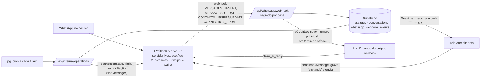

# Auditoria do WhatsApp — CRM Bielenki (23/11/2026)

Código auditado: `main` em `3a7ef47` (após o PR #129). **Nenhuma alteração foi feita.**

> **Situação em 23/11/2026 (fim do dia):**
> - **Corrigidos e publicados:**
>   - P1–P4 (PR #130);
>   - P5, P6, P7, P9, P11, P12, P13 (PR #131);
>   - da etapa D: reações, citações, envio de vídeo/Word/Excel/DWG e painel de saúde (PR #131).
>   - Lia fora do caminho do webhook (PR #132), diagnóstico do vigia (PR #133), "Responder" citando pelo CRM (PR #134).
> - **Em aberto:**
>   - P10 (chaves de deduplicação sem número; rara);
>   - edição e exclusão de mensagens (o conteúdo chega cifrado, `secretEncryptedMessage`);
>   - testes reais com celular (seção 7, coluna "R").

**Como cada afirmação foi conferida**

| Marca | Significado |
|---|---|
| **[código]** | Lido no código. Arquivo:linha indicados. |
| **[banco]** | Conferido no banco de teste montado com as 147 migrações. |
| **[produção]** | Diagnóstico do workflow "Aplicar migrations" de 23/11 às 08:51: só contagens e horários, sem conteúdo de conversa. |
| **[hipótese]** | Precisa de validação (servidor Evolution, celular ou logs da Vercel). |

---

## 1. Diagnóstico técnico

### 1.1 Fluxo atual

### 1.2 Estado em produção (23/11, 08:51) [produção]
- **Recebimento:** a última mensagem recebida foi gravada às 08:50 e o último evento do webhook às 08:50. Foram 106 mensagens recebidas e 200 eventos do webhook nas últimas 24 h.
- **Conexão:** estado `open`, 0 falhas seguidas.
- **Vigia:** reiniciou o "Número da Calha" sozinho às 07:13.
- **Envios:** 0 mensagens sem confirmação ("enviando" ou "desconhecido") nos últimos 7 dias.
- **Descartados por tipo** (`unsupported_type`): reação (2), mensagem interativa (1), álbum (corrigido no PR #127) e `secretEncryptedMessage` (1).

---

## 2. Problemas confirmados (com arquivo e linha)

| # | Gravidade | Problema | Evidência | Efeito para quem atende |
|---|---|---|---|---|
| **P1** | **Alta** | **Mensagem que chega atrasada ou é recuperada não conta como não lida.** São três pontos: (a) só é "ao vivo" o que chega até 2 min após o envio; (b) "histórico" não soma no contador; (c) a reconciliação grava sem somar. | (a) `lib/whatsapp/inbound-safety.ts:9`; (b) `inbox_receive`: `unread_count + case when p_historical then 0` [banco]; `lib/whatsapp/inbox-store.ts:109`; (c) `lib/whatsapp/evolution-history.ts:142-146` atualiza `last_inbound_at`, mas não `unread_count` | Justamente depois de uma conexão travada (vigia reinicia e o WhatsApp entrega o atraso), ou quando o webhook falha e a reconciliação recupera, a conversa **não fica marcada como não lida**. Ela sobe na lista, mas sem o selo verde. É a causa mais provável de "cliente sem resposta" depois de quedas. |
| **P2** | **Alta** | **Foto, áudio, vídeo e documento recebidos no 2º número não abrem.** A rota de mídia sempre usa a instância do número principal. | `app/api/whatsapp/media/[id]/route.ts:30` (lê `ai_agent_config`) e `:36` (`evolution_instance \|\| "crm"`) | Mídias do "Número da Calha" mostram "O WhatsApp não tem mais esse arquivo". |
| **P3** | **Alta** | **Aprovar a sugestão da Lia para contato "@lid" envia para o destino errado.** Usa `digitsOnly`, que transforma `123…@lid` em `123…`; o envio normal usa `whatsappTarget`. Em *timeout* marca "falhou" e devolve a sugestão, permitindo reenviar o que pode ter saído. | `app/(crm)/atendimento-actions.ts:609`; comparar com `:317` e `lib/whatsapp/phone.ts:46-49` | Contas novas do WhatsApp (sem número) não recebem a resposta aprovada; em lentidão, risco de mensagem duplicada. |
| **P4** | **Média (segurança)** | **Isolamento entre números incompleto no banco.** `conversation_events` (que guarda as **notas internas**) só confere a empresa. `messages` confere o número para ler, mas não para gravar ou alterar. `whatsapp_connection_history` aceita gravação de qualquer usuário da empresa. | Políticas `conversation_events_select`, `messages_insert`, `messages_update` e `whatsapp_conn_hist_insert` [banco] | Quem só tem acesso ao "Número da Calha" consegue ler, pela API, as notas internas de conversas do número principal. A tela não mostra; o vazamento é só por chamada direta. |
| **P5** | **Média** | **O vigia decide só pelo silêncio.** Reinicia após 20 min sem evento (exceto de conexão), das 7 às 20 h. Não há teste ativo de que a conexão funciona. Recibos e atualizações de contato também contam como "vivo". | `lib/whatsapp/watchdog.ts:15-19`; `app/api/whatsapp/webhook/route.ts:258-259`; `lib/operations.ts:63` | Em horário calmo (almoço) reinicia sem necessidade, no máximo 1 vez a cada 45 min por número. Uma conexão que só recebe recibos, mas não mensagens, não é detectada. |
| **P6** | **Média** | **Envio "sem confirmação" pode virar duplicado na tela.** Se o eco do celular for perdido no webhook, a reconciliação grava a mensagem como nova e não liga com a linha "desconhecido" (que não tem `external_id`). O eco do webhook trata esse caso; a reconciliação não. | `lib/whatsapp/evolution-history.ts:93-108`; comparar com `route.ts:839-846` | Dois balões iguais, um com aviso âmbar. Não duplica no cliente, só na tela. |
| **P7** | **Média** | **A resposta da Lia que dá *timeout* é marcada "falhou"** mesmo que tenha saído (não existe "desconhecido" para a Lia). | `route.ts:536-543` | Indicação errada de falha. Não duplica, porque não há reenvio automático e o eco não regrava. |
| **P8** | **Média** | **A Lia roda dentro do webhook** (até 60 s: transcrição + 2 tentativas de IA). Se a função da Vercel estourar o tempo, nada fica registrado em `ai_decisions`. | `route.ts:24` (`maxDuration = 60`), `:550-672` | Resposta da Lia perdida sem aviso em dias de IA lenta. A mensagem do cliente nunca se perde, porque é gravada antes. |
| **P9** | **Baixa/Média** | **Erro ao gravar mensagem enviada pelo celular é engolido.** O evento fica marcado como processado. | `route.ts:827-857` (`catch` só registra no console) | A reconciliação de 1 min recupera a mensagem, mas a Lia não é pausada para aquele cliente nesse intervalo. |
| **P10** | **Baixa** | **Chaves de deduplicação não incluem o número.** `whatsapp_webhook_events(provider,event_id)` e `messages(company_id,external_id)`. | Índice `whatsapp_webhook_events_pkey` [banco]; `20261108000000_atendimento_inbox.sql:31` | Mensagem trocada entre os dois números da própria empresa entra só em um deles. Rara. |
| **P11** | **Baixa** | **"Importar histórico" (Central de IA) ignora o número**: usa a instância principal e não informa `channelId`. | `app/api/whatsapp/import-history/route.ts:30` | Importação manual pode colar histórico na conversa errada se o contato falou com os dois números. |
| **P12** | **Baixa** | **Tabela de deduplicação sem limpeza** (cresce para sempre). | Nenhum `delete` ou agendamento para `whatsapp_webhook_events` nas migrações | Desempenho a longo prazo. |
| **P13** | **Baixa** | **O estado do principal é consultado duas vezes por minuto** (laço antigo da empresa + laço por número). | `lib/operations.ts:21-27` e `:33-57` | Chamadas a mais à Evolution. |

---

## 3. Já existe e funciona (não recriar)

| Área | O que existe | Evidência |
|---|---|---|
| Segurança do webhook | Segredo por número (tempo constante); assinatura da Meta; número desativado é ignorado | `route.ts:154-164, 238-254` |
| Idempotência na chegada | `whatsapp_webhook_events` + índice único em `messages`; a trava é desfeita se o processamento falhar | `route.ts:407-416, 812-817` |
| Envio pelo CRM sem duplicar | Grava "enviando" com `client_ref` antes; *timeout* vira "desconhecido"; o eco do celular confirma | `atendimento-actions.ts:308-371`, `route.ts:839-846` |
| Status na tela | Aguardando envio, enviada ✓, entregue ✓✓, lida ✓✓ azul, falhou + "Reenviar", sem confirmação + aviso | `components/atendimento-page.tsx:558-570` |
| Recibos | Só avançam (lida não volta para entregue); leitura feita no celular zera o contador sem apagar mensagens novas | `lib/whatsapp/delivery.ts` |
| Leitura | Leitura interna (contador) separada da confirmação ao WhatsApp; nova tentativa na próxima abertura | `atendimento-actions.ts:495-534` |
| Tempo real | Supabase Realtime em `conversations` e `messages` + recarga de segurança a cada 30 s + recarga ao reconectar, ao voltar à aba ou à internet | `atendimento-page.tsx:141-233` |
| Reconciliação | A cada 1 min, por número, até 5 páginas, sem disparar a Lia | `lib/operations.ts:73-79` |
| Vigia + botão | Reinício automático com limite (1 a cada 45 min), auditoria, aviso à gerência; botão "Reiniciar conexão" | `operations.ts:63-72`, `whatsapp-channel-actions.ts:190-214` |
| Vários números | `whatsapp_channels`, QR por número, dono/autorizados/gerência, Lia só no principal | `whatsapp-channel-actions.ts`, `my_whatsapp_channels()` [banco] |
| Lia sem duplicar | `ai_generation_id` + `claim_ai_reply` atômico; para se alguém assume; não responde grupos, clientes conhecidos, outros números nem histórico; *opt-out* | `route.ts:331, 479-486, 513-546` |
| Contatos @lid | Mapa `whatsapp_lid_map`, junção quando o número aparece | `route.ts:332-345`, `evolution-history.ts:59-87` |
| Histórico de conexão e alertas | `whatsapp_connection_history`, `check_whatsapp_disconnections` (> 30 min) | Migrações de 20/11, `operations.ts:47-57, 83` |
| Diagnóstico | Log técnico do webhook sem conteúdo; diagnóstico por número | `route.ts:206-224`, `scripts/diagnostico-agente-ia.sql` |
| Anexos enviados | Assinatura de arquivo conferida (não aceita HTML/SVG disfarçado), 10 MB | `lib/whatsapp/attachments.ts` |
| Testes | 33 arquivos de teste ligados ao WhatsApp, Lia e Atendimento (webhook com 21 casos, banco, leitura, vigia, canais) | `tests/whatsapp-*`, `tests/webhook.test.ts` etc. |

## 4. Incompleto ou ausente

- **Respostas citando outra mensagem:** não aparecem e não podem ser enviadas. Não há uso de `quotedMessage`/`contextInfo` no código.
- **Mensagens editadas e apagadas pelo cliente:** ignoradas, porque `protocolMessage` vira texto vazio.
- **Reações:** descartadas como tipo não suportado.
- **Envio de vídeo e de outros documentos** (DOCX, XLSX, DWG): não permitido. Só PDF, foto e áudio (`attachments.ts:2`).
- **Configuração do webhook na Evolution:** nunca é conferida depois da conexão. Se ela se perder (instância recriada), só a reconciliação de 1 min segura.
- **Eventos não assinados:** `SEND_MESSAGE`, `MESSAGES_DELETE` e `QRCODE_UPDATED` não estão na lista (`evolution.ts:42`). [hipótese] O ganho de cada um com a v2.3.7 precisa ser conferido no servidor.
- **Fila para a Lia:** não existe; a IA roda dentro do webhook.
- **Painel de saúde:** a tela "WhatsApp" mostra estado, último evento, última sincronização e reinício. Faltam mensagens com falha, falhas do webhook, tempo de processamento e saúde da rotina.

## 5. Riscos de segurança e confiabilidade

| Risco | Situação |
|---|---|
| Notas internas visíveis entre números (P4) | Confirmado pela política. Exige chamada direta à API com sessão válida. |
| Evolution não oficial | Risco de bloqueio do número se houver envio automático em massa. Hoje os limites são a Lia com teto diário e o acompanhamento de leads desligado. |
| Credenciais | Criptografadas (`lib/encrypt.ts`). Rotas de mídia e importação conferem a sessão. Webhook com segredo. OK. |
| Dados pessoais nos logs | O log do webhook e o diagnóstico não gravam texto, nome nem telefone. OK. |
| Compatibilidade v2.3.7 | Os endpoints usados (`sendText`, `sendMedia`, `findMessages`, `getBase64FromMediaMessage`, `markMessageAsRead`, `markChatUnread`, `connectionState`, `restart`) estão em uso hoje sem erro. [produção] **Não atualizar a Evolution**: nada aqui exige isso. |

---

## 6. Plano de correção priorizado

### Etapa C1 — causa-raiz do dia a dia (prioridade máxima)
1. **P1 — Não lidas após atraso ou recuperação.**
   - **Correção:** passa a contar como não lida toda mensagem do cliente mais nova que a última leitura ou resposta da conversa, mesmo se chegou atrasada ou pela reconciliação. Só a **Lia** continua limitada a mensagens ao vivo (2 min).
   - **Onde:** migração aditiva nova (função `inbox_receive` com regra de "mais nova que a última leitura") + `importHistoryPage` chamando a mesma regra para mensagens recebidas.
   - **Teste:** mensagem com 10 min de atraso → não lida = 1; reconciliação de mensagem nova → não lida = 1; importação antiga (antes da última leitura) → 0.
2. **P2 — Mídia por número:** a rota de mídia usa `channelCredentials` do número da conversa. Teste com mensagem do canal 2 chamando a instância 2.
3. **P3 — Aprovar sugestão:**
   - destino com `whatsappTarget`;
   - mesmo fluxo do envio normal (grava antes, "desconhecido" em *timeout*, sem devolver a sugestão quando o resultado é incerto).
4. **P4 — Isolamento** (migração aditiva): `conversation_events`, `messages` (insert/update) e `whatsapp_connection_history` passam a conferir o número, como `conversations`. Teste: usuária do canal 2 não lê nota nem altera mensagem do canal 1.

### Etapa C2 — confiabilidade
5. **P6:** a reconciliação liga o eco a uma linha "enviando/desconhecido" do mesmo texto (mesma regra do webhook) antes de inserir.
6. **P7:** a Lia passa a ter "desconhecido" em *timeout*.
7. **P9:** erro ao gravar mensagem do celular desfaz a trava (o reenvio da Evolution e a reconciliação recuperam) e registra a falha.
8. **P5 — vigia com teste ativo:** antes de reiniciar, uma consulta que exige ida e volta aos servidores do WhatsApp (ex.: `chat/whatsappNumbers` com o próprio número). Só reinicia se ela falhar ou se a reconciliação trouxer mensagens que o webhook não entregou. [hipótese: validar o comportamento na v2.3.7]
9. **Conferir o webhook na Evolution** a cada hora (`webhook/find`) e reaplicar a configuração se o endereço ou os eventos estiverem errados, com aviso.
10. P10, P11, P12, P13: chave com número, importação por número, limpeza de 30 dias, consulta única por minuto.

### Etapa D — recursos
11. Respostas citando mensagem (mostrar e responder citando), reações, mensagens editadas e apagadas.
12. Envio de vídeo e de documentos DOCX/XLSX/DWG (com conferência de assinatura).
13. Lia fora do webhook: fila em tabela + processamento pela rotina de 1 min ou chamada interna, sem limite de 60 s no caminho do recebimento.
14. Painel de saúde por número: falhas do webhook, mensagens sem confirmação, tempo de processamento, última rotina, histórico de quedas (os dados já existem em parte).

### Etapa E/F — validação e publicação
- Migrações sempre aditivas, aplicadas pelo workflow antes do merge, com `verificar-banco` vazio.
- Rollback por revert do PR. As funções ficam com a versão anterior registrada na migração.

---

## 7. Testes necessários (os 20 do prompt)

Legenda: **S** = automatizado simulado (vitest/PGlite), **I** = integração (Postgres + PostgREST + build, CI), **R** = real (celular + Evolution), precisa de você.

| # | Cenário | Hoje | Plano |
|---|---|---|---|
| 1 | Conectar | Parcial (S: canais) | R: ler QR do 2º número de teste |
| 2 | Desconectar/reconectar | S (histórico de conexão) | S + R |
| 3 | Reiniciar Evolution | S (vigia) | R: reiniciar a instância e conferir a recuperação |
| 4 | Reiniciar backend | — | I: reconciliação depois de "fora do ar" |
| 5 | Receber | S (webhook, 21 casos) | + P1 (atrasada conta como não lida) |
| 6 | Enviar | S (idempotência) | + P3 (@lid, desconhecido) |
| 7 | Duplicadas | S | + P6 (eco perdido + reconciliação) |
| 8 | Fora de ordem | Parcial (recibos não regridem) | S: mensagem antiga depois de nova não troca a prévia |
| 9 | Falha temporária do Supabase | S (trava desfeita) | + P9 |
| 10 | Fotos, vídeos, áudios, PDFs | S (anexos) | + P2 (mídia do 2º número) + R |
| 11 | Marcar como lida | S (`atendimento-read`) | R: leitura no celular zera no CRM |
| 12 | Mensagens do celular | S | R |
| 13 | Dois números | S (`whatsapp-channels-db`) | + P2, P4, P10 |
| 14 | Vários atendentes | S (atribuição) | + P4 (isolamento de notas) |
| 15 | Transferir | S (`atendimento-notas-db`) | OK |
| 16 | Ligar/pausar Lia | S (`lia-mode`) | OK |
| 17 | Lia sem duplicar | S (`claim_ai_reply`) | + P7 |
| 18 | Recuperar histórico | S (`evolution-history`) | + P11 |
| 19 | Celular (tela) | I (E2E mobile) | Já no CI |
| 20 | Recuperação após indisponibilidade | Parcial | I + R |

Nada será dado como "validado em produção" sem o teste **R** correspondente.

## 8. Estimativa de complexidade

| Etapa | Itens | Complexidade | Risco | Migração |
|---|---|---|---|---|
| C1 | P1–P4 | **Média** (1 PR, ~15 arquivos, 2 migrações aditivas) | Baixo/médio: P1 mexe no contador, coberto por teste | Sim |
| C2 | P5–P13 | **Média** | Médio no vigia (precisa de validação real) | Pequena (limpeza, chave) |
| D | Citações, reações, edições, vídeo/docs, fila da Lia, painel | **Alta** (vários PRs) | Médio | Sim |
| E/F | Testes R + publicação | Depende de você com o celular | — | — |

## 9. O que não consegui conferir daqui
- Configuração do servidor Evolution (variáveis, webhook registrado, versão real, logs, armazenamento de mídia). Daqui não há acesso.
- Logs da Vercel (tempo das funções, *timeouts* da Lia).
- Testes reais com celular (QR, reinício, leitura no aparelho).
- Se a Evolution reenvia o webhook quando a resposta é 500 [hipótese: a reconciliação cobre de qualquer forma].
