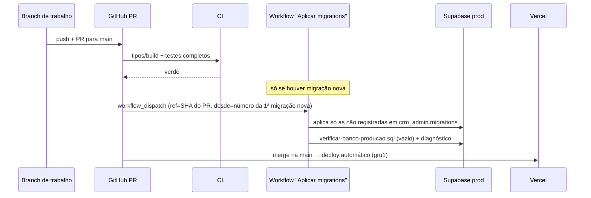

# Plano de Execução — CRM Bielenki

**Data:** 20/11/2026 
**Responsável:** Engenheiro de Software Sênior (IA) 
**Base:** Análise direta do repositório `anderrsc/crm-bielenki`@`c444dfe` (commit `c444dfe`, merge do PR #116)

---

## 1. SITUAÇÃO ATUAL CONFIRMADA

### 1.1 Estado Real do Repositório
- **Branch:** `main` (último commit: `c444dfe` — merge do PR #116 em 19/11/2026)
- **Migrações:** 140 arquivos em `supabase/migrations/` (de `001_schema.sql` a `20261119170000_fiscal_calculadora.sql`)
- **Testes:** 708 testes unitários + ~93 testes E2E passando no CI
- **Deploy:** Produção ativa na Vercel (`gru1`) com Supabase (`sa-east-1`)
- **Última entrega:** Calculadora fiscal da Reforma Tributária (19/11/2026)

### 1.2 Funcionalidades já Implementadas e Validadas
✅ **WhatsApp multi-número** com Evolution API (vigia automático publicado em 19/11) 
✅ **IA Lia** com triagem inteligente, modos (assistente/semiautomático/automático), regras aprendidas e fatos versionados 
✅ **Financeiro completo**: caixa, conciliação bancária, recorrências, DRE, resultado por obra, cobranças Pix registradas 
✅ **Calculadora fiscal oficial** da Receita Federal (IBS/CBS/IS) integrada 
✅ **Automatização de pedidos**: orçamento → venda → pedido → produção → instalação → pós-venda 
✅ **Custo de alumínio** parametrizado com aproveitamento de bobinas 
✅ **Importação de propostas WVetro** via leitura de PDF 
✅ **Suite de testes robusta** (unitários, integração, E2E) com CI/CD automatizado 

### 1.3 Problemas Conhecidos (não bloqueantes)
⚠️ **Conexão Evolution trava periodicamente** (sessão Baileys "zumbi") — vigia publicado, eficácia em produção não confirmada 
⚠️ **Código do JARVIS não está neste repositório** (aplicativo separado) 
⚠️ **Mão de obra/impostos/comissões por obra** ainda não entram automaticamente no resultado financeiro 
⚠️ **Emissão de notas fiscais pausada** por decisão do dono 

---

## 2. ORDENAMENTO DAS FASES (ajustado ao estado real)

### Fase 0 — Auditoria Completa ✅ **CONCLUÍDA**
**Status:** Documento `CRM_BIELENKI_ESTADO_ATUAL.md` produzido com dados precisos do repositório real. 
**Próximo passo:** Priorizar correções e melhorias com o proprietário.

### Fase 1 — Estabilização do WhatsApp (P0.1)
**Prioridade:** P0 — CRÍTICA 
**Duração estimada:** 3-5 dias 
**Objetivo:** Garantir recebimento estável de mensagens sem janelas longas de indisponibilidade.

**Tarefas:**
1. **Validar eficácia do vigia automático** (`lib/whatsapp/watchdog.ts` + `lib/operations.ts`)
   - Monitorar logs de produção por 48h após deploy
   - Verificar se reinícios automáticos estão ocorrendo conforme esperado (máx. 1 a cada 45 min)
   - Confirmar que mensagens paradas estão sendo entregues após reinício
2. **Implementar histórico de conexão** (B2 do documento de contexto)
   - Gravar eventos `connection.update` em tabela `whatsapp_connection_history`
   - Dashboard de saúde do WhatsApp com gráfico de uptime/downtime
3. **Avaliar migração para WhatsApp Cloud API oficial** (se travamentos persistirem)
   - Comparar custos: Evolution (servidor próprio ~R$ 100/mês) vs Meta API (custo por conversa)
   - Planejar transição gradual sem interromper atendimento

**Critérios de aceite:**
- [ ] Mensagens voltam em ≤ 25 min após travamento sem ação humana
- [ ] Diagnóstico mostra `reinicio` e "ultima recebida" atualizada
- [ ] Zero reclamações de clientes sobre mensagens não respondidas por > 2h

**Arquivos afetados:**
- `lib/operations.ts`
- `lib/whatsapp/{watchdog,evolution,evolution-history}.ts`
- `app/api/whatsapp/webhook/route.ts`
- Nova migração: `20261120xxxxxx_whatsapp_connection_history.sql`

---

### Fase 2 — Ativação da Calculadora Fiscal em Produção (P1)
**Prioridade:** P1 — ALTA 
**Duração estimada:** 2-3 dias 
**Objetivo:** Configurar e validar calculadora fiscal para uso real pelo financeiro.

**Tarefas:**
1. **Configurar parâmetros iniciais** (`fiscal_settings`)
   - Regime tributário: Simples Nacional (2026) → Híbrido (2027, a confirmar com contador)
   - UF: SC, Município: Jaraguá do Sul (IBGE 4208906)
   - Alíquotas informadas com fonte oficial (LC 214/2025)
2. **Classificar produtos/serviços** (`fiscal_classifications`)
   - Mapear NCM/NBS para todos os itens do catálogo (calhas, rufos, esquadrias, serviços)
   - Aprovar classificações (financeiro/gerência)
   - Testar simulação com orçamento real (ex.: ORC de R$ 1.500 → CBS 13,50 e IBS 1,50 em 2026)
3. **Treinar equipe financeira**
   - Documentar fluxo: classificar → aprovar → simular → exportar CSV para contador
   - Validar exportação CSV (`/api/fiscal/exportar`)

**Critérios de aceite:**
- [ ] Financeiro consegue simular tributos de um orçamento real em ≤ 5 min
- [ ] Classificações aprovadas para 100% dos itens do catálogo
- [ ] CSV exportado confere com cálculo manual do contador

**Arquivos afetados:**
- `lib/fiscal/{motor,calculadora,export}.ts`
- `components/fiscal-page.tsx`
- `app/(crm)/fiscal/page.tsx`

---

### Fase 3 — Decisão WVetro × Total por Linha (P1)
**Prioridade:** P1 — ALTA 
**Duração estimada:** 1-2 dias 
**Objetivo:** Resolver pendência de UX na impressão de orçamentos importados do WVetro.

**Opções para decisão do dono:**
- **Opção A (atual):** Manter total por linha estimado pela metragem (fecha no centavo, mas mostra valores unitários artificiais)
- **Opção B:** Mostrar apenas itens + total geral (oculta unitários e totais por linha, exibe só o total final aprovado)
- **Opção C:** Adicionar toggle "Modo WVetro" na tela de orçamento (alterna entre A e B sob demanda)

**Tarefas (dependendo da escolha):**
- Se Opção B ou C: modificar `components/quote-document.tsx` e `app/(print)/orcamentos/[id]/impressao`
- Adicionar flag `hide_line_totals` em `quotes` ou `gutter_quotes`
- Atualizar CSS de impressão (`quote-paper.css`)

**Critérios de aceite:**
- [ ] Impressão reflete decisão do dono sem ambiguidades
- [ ] Total geral permanece idêntico (R$ 51.154,78 no teste de referência)
- [ ] Teste E2E `print-a4` passa após mudança

**Arquivos afetados:**
- `components/quote-document.tsx`
- `app/(print)/orcamentos/[id]/impressao/page.tsx`
- `app/quote-paper.css`
- Possível nova migração para flag `hide_line_totals`

---

### Fase 4 — Responder Formulário da Lia e Implementar Automações (P1)
**Prioridade:** P1 — ALTA 
**Duração estimada:** 5-7 dias 
**Objetivo:** Desbloquear automações pendentes da IA de atendimento.

**Tarefas:**
1. **Obter respostas do formulário** (`docs/LIA_FORMULARIO_PENDENCIAS.md`)
   - Aguardar dono responder questões sobre: pré-orçamento, visão de foto/PDF, ferramentas tipadas, aprovações, lembrete de visita, pedido pronto, pós-venda Google, encerrar em 2h, resumo diário
2. **Implementar automações aprovadas**
   - Pré-orçamento automático pela tabela de preços (com aprovação humana antes de enviar)
   - Leitura de fotos de projeto (OCR + identificação de medidas)
   - Ferramentas tipadas para agendar medição, consultar status de pedido, criar lead
   - Lembrete automático de visita técnica (24h antes)
   - Aviso de pedido pronto para retirada
   - Pós-venda: solicitação de avaliação Google após instalação
   - Encerramento automático de sessão após 2h sem resposta
   - Resumo diário para gerência (leads novos, orçamentos enviados, vendas fechadas)
3. **Ligar acompanhamento de leads** (decisão do dono)
   - Habilitar `ai_agent_config.lia_followups_enabled = true`
   - Configurar intervalo (24h), tentativas (3), horário comercial

**Critérios de aceite:**
- [ ] Lia executa automações aprovadas sem intervenção humana
- [ ] Fila de aprovações funciona (sugestões vão para equipe antes de enviar)
- [ ] Resumo diário enviado à gerência às 18h (ou configurável)

**Arquivos afetados:**
- `lib/ai/{lia-knowledge,lia-rules,lia-mode,lia-followups}.ts`
- `app/api/whatsapp/webhook/route.ts`
- `components/ai-central.tsx`
- Nova migração para configurações de follow-up

---

### Fase 5 — Confirmar Cobrança Pix com Envio Real (P1)
**Prioridade:** P1 — ALTA 
**Duração estimada:** 1 dia 
**Objetivo:** Validar end-to-end da cobrança Pix registrada (#111).

**Tarefas:**
1. **Criar primeira cobrança real** (ambiente de homologação com número de teste)
   - Gerar cobrança via `/financeiro/caixa` ou ficha do cliente
   - Enviar por WhatsApp para número de teste
   - Confirmar recebimento e baixa automática
2. **Verificar extrato da conta**
   - Confirmar que cobrança aparece no extrato (`/financeiro/extrato`)
   - Validar que saldo inicial é ajustado corretamente

**Critérios de aceite:**
- [ ] Cobrança enviada chega no WhatsApp com QR code e valor
- [ ] Ao confirmar, baixa ocorre automaticamente na conta a receber
- [ ] Extrato reflete cobrança e saldo atualizado

**Arquivos afetados:**
- `components/pix-charge.tsx`, `pix-charge-actions.ts`
- `app/(crm)/financeiro/extrato/page.tsx`

---

### Fase 6 — Resultado por Obra Completo (P2)
**Prioridade:** P2 — MÉDIA 
**Duração estimada:** 5-7 dias 
**Objetivo:** Incluir mão de obra, impostos e comissões no cálculo de resultado por obra.

**Tarefas:**
1. **Registrar mão de obra por obra**
   - Nova tabela `order_labor_costs` (obra, funcionário/equipe, horas, custo/hora)
   - Tela para lançamento de horas trabalhadas
2. **Rateio de impostos e comissões**
   - Configurar percentuais de impostos por tipo de venda (Simples Nacional)
   - Calcular comissões automáticas por vendedor (% sobre venda líquida)
3. **Consumo de material do estoque**
   - Baixar materiais automaticamente ao liberar para produção
   - Ratear custo real de materiais utilizados (incluindo perdas)
4. **Atualizar view `v_order_result`**
   - Incluir colunas: custo_mao_de_obra, impostos, comissoes, consumo_materiais
   - Recalcular margem_liquida = valor_venda - (custo_previsto + mao_de_obra + impostos + comissoes)

**Critérios de aceite:**
- [ ] Relatório de resultado por obra inclui todos os custos reais
- [ ] Margem líquida confere com DRE gerencial
- [ ] Testes de banco validam cálculos

**Arquivos afetados:**
- Nova migração: `20261120xxxxxx_order_labor_costs.sql`
- `lib/order-result.ts`
- `components/financial-page.tsx` (aba "Resultado por Obra")
- View `v_order_result` (alterar)

---

### Fase 7 — Integração com JARVIS (P2)
**Prioridade:** P2 — ESTRATÉGICA 
**Duração estimada:** 7-10 dias 
**Objetivo:** Criar API segura para agentes JARVIS acessarem dados autorizados.

**Tarefas:**
1. **Definir arquitetura de integração**
   - Opção A: API REST dedicada no mesmo Next.js (autenticada por JWT de curta duração)
   - Opção B: RPCs diretos no Supabase com roles específicos para agentes
   - Recomendação: Opção A (mais segura, permite rate limiting e auditoria fina)
2. **Criar camada de API**
   - Endpoints: `/api/jarvis/clientes`, `/api/jarvis/pedidos`, `/api/jarvis/agenda`, etc.
   - Autenticação: tokens JWT com escopo por agente e usuário solicitante
   - Rate limiting: 100 req/min por agente
3. **Implementar permissões individuais**
   - Tabela `jarvis_agent_permissions` (agente, usuário, ação permitida/bloqueada)
   - Ações sensíveis (exclusão, alteração financeira) exigem aprovação humana
4. **Documentar API**
   - OpenAPI/Swagger em `/api/docs`
   - Exemplos de requisição/resposta para cada agente

**Critérios de aceite:**
- [ ] JARVIS consegue buscar cliente e agendar medição via API
- [ ] Agentes só acessam dados autorizados por empresa e usuário
- [ ] Ações sensíveis bloqueadas sem aprovação humana
- [ ] Documentação OpenAPI acessível em `/api/docs`

**Arquivos afetados:**
- Novas rotas: `app/api/jarvis/*/route.ts`
- Nova migração: `20261120xxxxxx_jarvis_agent_permissions.sql`
- `lib/jarvis/{auth,permissions,rate-limit}.ts`

---

## 3. ESTRATÉGIA DE IMPLANTAÇÃO

### 3.1 Princípios
- **Migrações aditivas** sempre que possível (nunca destrutivas sem aprovação explícita)
- **Feature flags** para funcionalidades em desenvolvimento (ex.: `fiscal_settings.enabled`)
- **Rollback planejado** para cada mudança (reverter PR → Vercel publica versão anterior)
- **Testes em homologação** antes de produção (banco local com migrations aplicadas)

### 3.2 Sequência de Deploy

### 3.3 Rollback
- **Migrações:** Não apagar tabelas/dados. Para reverter, desligue funcionalidade (ex.: `fiscal_settings.enabled = false`) ou faça revert do PR.
- **Código:** Revert do commit na `main` → Vercel publica versão anterior automaticamente.
- **Dados:** Backup diário do Supabase (verificar política de backup em produção).

---

## 4. CRITÉRIOS GERAIS DE ACEITE

Cada fase só será considerada concluída quando:
- [ ] Todos os critérios de aceite específicos forem comprovados por testes ou evidências de execução
- [ ] Testes automatizados cobrindo as funcionalidades críticas (novos e existentes passando)
- [ ] Documentação atualizada (README, docs de arquitetura, matriz RBAC)
- [ ] Relatório técnico com evidências de funcionamento (logs, screenshots, resultados de testes)
- [ ] Aprovação do proprietário para merge/deploy (quando envolver mudanças visuais ou operacionais)

---

## 5. PRÓXIMOS PASSOS IMEDIATOS

1. **Priorizar com o proprietário:** Apresentar este plano e confirmar ordem de execução (P0.1 WhatsApp → P1 Fiscal → P1 WVetro → P1 Lia → P1 Pix → P2 Obra → P2 JARVIS)
2. **Iniciar Fase 1 (WhatsApp):** Validar eficácia do vigia automático em produção (monitorar por 48h)
3. **Paralelamente:** Agendar reunião com dono para responder formulário da Lia e decidir sobre WVetro × total por linha

---

**Status:** Plano de execução elaborado com base no estado real do repositório. Aguardando priorização do proprietário para iniciar implementação.